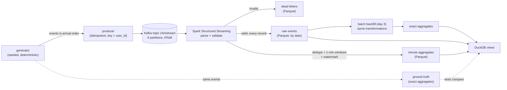

# FlowCast design

FlowCast is a streaming analytics pipeline small enough to run on one laptop and honest enough to measure: a
synthetic clickstream goes through Kafka and a Spark Structured Streaming job into Parquet, and DuckDB answers
questions over the result. This document is the specification for all five days; each day's section says what that
day delivers and how it is tested.

The question the pipeline answers: **per minute of event time, how many events of each type happened, and how much
revenue did purchases bring in?** And the two questions behind it that make a streaming system interesting: **how
fresh is that answer** (event time to queryable), and **how right is it** when events arrive late, twice, or not in
order.

## The pipeline

Every arrow on the right of Kafka is day 2 or later. Day 1 builds the left side: the event schema, the generator and
its ground truth, a local Kafka, the round trip through it, and CI.

## The event (schema version 1)

One JSON object per Kafka record, UTF-8, compact (`,` and `:` separators, no spaces), keys always in the order below
and always present (`null` where a field doesn't apply), so the same event is always the same bytes.

| Field | Type | Rule |
|---|---|---|
| `schema_version` | int | `1` |
| `event_id` | string | 36-character lowercase UUID; unique per event, **the same on a re-sent copy** |
| `event_type` | string | `page_view`, `product_view`, `add_to_cart`, `remove_from_cart`, `checkout`, `purchase` |
| `event_time` | int | milliseconds since the Unix epoch, UTC, when the client says the event happened; 2000-01-01 ≤ t < 2100-01-01 |
| `user_id` | string | `u` + digits, at most 32 characters |
| `session_id` | string | `s` + digits, at most 32 characters |
| `device` | string | `desktop`, `mobile`, `tablet` |
| `country` | string | two uppercase letters |
| `page` | string | `/` then up to 255 printable ASCII characters, no spaces (a percent-encoded path) |
| `product_id` | string or null | `p` + digits, at most 32 characters; non-null exactly for `product_view`, `add_to_cart`, `remove_from_cart`, `purchase` |
| `category` | string or null | lowercase letters and `_`, 1 to 32 characters; non-null exactly when `product_id` is |
| `price_cents` | int or null | unit price, 1 to 10,000,000; non-null exactly when `product_id` is |
| `quantity` | int or null | 1 to 99; non-null exactly for `add_to_cart`, `remove_from_cart`, `purchase` |

Decisions:

- **Money is integer cents.** Revenue is `Σ price_cents × quantity` over purchases, an exact integer sum in Python,
  DuckDB (`BIGINT`/`HUGEINT`) and Spark (`LONG`), so the three can be compared with `==`, not a tolerance.
- **Event time is an integer of milliseconds**, not an ISO string: no time-zone or parsing ambiguity, and Spark turns
  it into a timestamp with `timestamp_millis`.
- **Booleans are not integers.** Python's `json` reads `true` as `True`, and `True` is an `int`; the decoder refuses
  it. Floats are refused too (`1.0` is not a valid `quantity`).
- **Unknown keys are refused in version 1.** Day 3's schema evolution adds version 2 with one optional field and
  readers that accept both; until then a stray key means a producer bug, and a dead letter is the right place for it.
- **One purchase event per cart line**, so revenue by category needs no join.

`src/flowcast/schema.py` holds the field list, the strict decoder (`decode`, which raises `InvalidEvent` with a
reason) and the encoder (`encode`). The decoder is the reference for day 2's validation in Spark: a differential test
feeds the same good and bad records to both and requires the same verdicts.

## The generator

`src/flowcast/generator.py` produces an endless stream of events **in arrival order**, the order a collector would
receive them, which is the order the producer writes them to Kafka. It is the only data source, so it has to make
every hard case of streaming happen on purpose, at a known rate:

- **Users and sessions.** A fixed pool of users (each with a device and a country) and a catalog of products (each
  with a category and a price). Sessions start as a Poisson process in event time (`sessions_per_second`); each picks
  a user (skewed: some users are much more active) and walks a Markov chain over event types (landing `page_view`,
  then `product_view`, `add_to_cart`, `remove_from_cart`, `checkout`, `purchase` lines, or exit), with exponential
  think times between steps. A checkout is only reachable with a non-empty cart; a purchase writes one event per cart
  line. A session ends rather than take a step that would put it past `max_session_events` (60) events.
- **Disorder.** Each event's arrival time is its event time plus a small network delay (5 to 250 ms). A fraction
  (`late_fraction`, 3%) arrive *late*: an extra exponential delay (mean 20 s, capped at 120 s), within the 3-minute
  watermark. The label says which group a record was drawn into, not how late it ended up: an exponential delay can
  be close to 0, so a few "late" records arrive as early as on-time ones. A smaller fraction (`very_late_fraction`, 0.2%) arrive *very late*: 5 to 30 minutes, past the watermark,
  so a streaming aggregate must drop them and only the backfill sees them.
- **Duplicates.** A fraction (`duplicate_fraction`, 1%) are sent twice: the copy has the same `event_id` and the same
  bytes, and arrives 0.1 to 5 s after the original (a client that retried after a lost acknowledgement). The idempotent
  Kafka producer can't remove these, because to Kafka they are two different sends; the pipeline must.
- **Bounded memory.** Sessions are generated in start-time order and their events go into a heap keyed by
  (arrival time, sequence number). An event can be emitted once the next session's start time is past its arrival
  time: every later event happens at or after that start and arrives no earlier. The heap holds the events still
  "in flight": at most `very_late_max_ms` of very late ones (30 minutes at the defaults), so memory grows with that
  setting times the event rate.
- **Determinism.** The same configuration and seed give the same events, byte for byte. Python only promises that
  `random.Random(seed).random()` keeps its sequence across versions (not `choice`, `randrange` or `expovariate`), so
  every draw is made from `random()` alone, and event ids are a hash of (seed, sequence number) rather than random
  bits. Exponential draws use `math.log`, which C libraries aren't required to round identically, so "on any machine"
  is checked rather than assumed: a test pins the SHA-256 of the first 10,000 records (arrival times and bytes), and CI
  runs it on Linux as the laptop does on macOS. A deliberate change to the generator re-pins it, in the same commit,
  saying why.

Each emitted record carries the event and its simulated arrival time, plus labels a real collector wouldn't have
(`late`, `very_late`, `duplicate`): the tests and the ground truth use them, the producer sends only the event.

## Ground truth

Because the generator made every event, the exact answer is known. `src/flowcast/truth.py` computes, from the
generated events with duplicates removed by `event_id`, per one-minute tumbling window of event time (`[start, start +
60 s)`, `start = floor(event_time / 60,000) × 60,000`, the same alignment as Spark's `window()`) and per event type:
the number of events and the purchase revenue in cents.

The same aggregate is written once in SQL (`src/flowcast/sql/minute_aggregates.sql`) and run by DuckDB over the same
events; a property test requires the Python and SQL answers to be equal for random generator settings. Day 2's Spark
output is then checked against this truth:

- **Which rows Spark drops** (confirmed on day 2). Streaming deduplication drops an input row whose event time is at
  or before the late-events watermark; a windowed aggregation in append mode drops a row whose window ends at or
  before it. Since Spark 3.4 a query may chain stateful operators, and the late-events watermark of every operator in
  batch *i* is **batch *i - 1*'s watermark**, not batch *i*'s own (`PropagateWatermarkSimulator` in
  `WatermarkPropagator.scala`, Spark 4.2.0: "We use watermark for previous microbatch to determine late events"); the
  batch's own watermark only decides what state to evict and which windows to write. A batch's watermark is the
  maximum event time of the batches before it minus the delay. `tests/test_spark_rules.py` feeds a file stream one
  file per batch with no-data batches off and confirms all of it on the job's own functions: a row below batch 1's
  watermark but read in batch 1 is kept (batch 0 had none), a row exactly on batch 1's watermark read in batch 2 is
  dropped, and chained, the window aggregate never drops a row the dedupe kept, so **the dedupe is the rule that
  drops events**.
- **The exact check** (`check.py`). Which records are dropped depends on where micro-batch boundaries fall, so the
  truth alone gives only a bound (`spark ≤ truth` in every window). A query's checkpoint keeps, for every batch, an
  offset-log entry (`offsets/<id>`: the Kafka end offsets it read up to, and `batchWatermarkMs`) and, once its output is
  done, a commit (`commits/<id>`); no-data batches (which only move the watermark) are entries too. Replaying the
  committed batches over the records in Kafka assigns each record to the batch that read it and drops a valid one
  whose event time is at or before the previous batch's watermark. The truth of the kept records, in the windows whose
  end is at or before the last batch's watermark, must equal Spark's output row for row. Spark deletes offset-log
  entries beyond `spark.sql.streaming.minBatchesToRetain` (100 by default), so the job raises it to 100,000, and the
  replay refuses a checkpoint that doesn't start at batch 0.
- **What the metric can and can't do.** `numRowsDroppedByWatermark` counts rows *at the operator*: input rows at
  the dedupe (a very late event sent twice counts twice), but partial aggregates (one per window and key per batch)
  at the window aggregation (five late events in one window can count once). So it's a cross-check of the dedupe's
  input, against the replay's count of dropped records; it isn't an event count of the output.
- **The watermark delay is 3 minutes**, above the late cap (2 minutes plus the network delay), so late records are
  kept by design and very late ones (5 minutes or more) are dropped, except near the end of a finite stream: once the
  last on-time events are in, the maximum event time stops moving, and very late records of the last 3 minutes arrive
  above the watermark and are counted.
- The batch backfill (day 3) reads every raw record, so its aggregates must equal the truth exactly, very late events
  included.

## Kafka

- **One broker in KRaft mode** (no ZooKeeper; Kafka 4 removed it), broker and controller in one process.
  Locally `scripts/kafka.sh` runs Homebrew's Kafka 4.3.1 on Java 21 with its config and data under `.kafka/` (ignored
  by git), broker on `127.0.0.1:9192`, controller on `127.0.0.1:9193` (the portfolio's port map), bound to loopback
  only. It stops only its own broker: the pid in its pid file counts only if that process's command line names this
  directory's config, since a pid file can outlive its process and pids are reused. CI runs the `apache/kafka` image
  of the same version as a service container.
- **The topic `clickstream`** has 6 partitions (one per laptop core Spark will use, and more than one so ordering
  across partitions is visibly not guaranteed) and replication factor 1 (one broker). Topics are created explicitly
  (`auto.create.topics.enable=false`), so a typo in a topic name is an error, not a new topic with the default
  partition count. Retention is bounded by size as well as time (`retention.bytes` per partition) to protect a laptop
  disk.
- **Key = `user_id`.** One user's events land in one partition, so Kafka keeps them in the order they were sent, and a
  session's events are processed in order by whichever Spark task reads that partition. Across users there's no order.
- **The producer is idempotent** (`enable.idempotence=true`, so `acks=all` and at most 5 in-flight requests): a
  retried send after a lost acknowledgement can't create a duplicate or reorder a partition. That covers the
  producer's own retries only; the generator's deliberate duplicates are separate sends and stay.
- **Created means served.** Right after a create, the broker's metadata and its leadership of each partition lag
  the controller for a moment: a racing creator can see no topic, and a reader can get "Not leader for partition".
  `ensure_topic` returns only once the broker lists the topic with a leader for every partition, and readers retry
  those two settling errors until their timeout.
- **Reading a snapshot.** Tests and tools read a topic up to the high-water marks taken when they start (`read_topic`),
  so a read always ends, with no consumer group and no committed offsets left behind.

## Spark (days 2 and 3)

PySpark 4.2 on Java 21, `local[*]`, reading Kafka with the `spark-sql-kafka-0-10` source (the same version, fetched
from Maven Central on first use). One streaming query per output, each with its own checkpoint; the transformations are
plain functions in `spark_job.py`, shared by the stream, the tests and day 3's backfill:

- **Parse and validate** (`parse`): `schema.decode` itself, in an Arrow Python UDF, gives each record's verdict and
  reason; a record that fails goes to dead letters with its Kafka coordinates (topic, partition, offset, timestamp),
  the raw bytes and the reason. `from_json` was the obvious alternative and can't give the same verdicts: tried on
  `{"a":1,"a":2,"z":5,"e":NaN}` it keeps the last of the two `a`s, ignores the unknown `z` and reads `NaN` as a
  number, where `decode` refuses all three. One definition of "valid" costs a Python call per record; day 4 measures
  it. A reason is made valid UTF-8 before it leaves the UDF (a quoted key can be a lone surrogate, which Arrow can't
  encode, and the throw would fail the whole query: the day-2 review).
- **Raw events**: every valid record, duplicates and very late ones included, with its Kafka partition, offset and
  timestamp, appended to Parquet partitioned by event date. No state, so nothing is ever dropped here.
- **Minute aggregates**: a watermark on event time (3 minutes by default; see "Ground truth"),
  `dropDuplicatesWithinWatermark("event_id")` (its state for an id is dropped once the watermark passes the id's event
  time plus the delay, so state stays bounded, unlike `dropDuplicates`), then one-minute tumbling windows by event type:
  count and revenue. Output mode `append`, so a window is written once, when the watermark passes its end. The price
  of that is latency: a window is at least window + delay + one trigger old when it appears; day 4 measures it.
- **Settings**: 6 shuffle partitions (the state stores per stateful operator, fixed for a checkpoint's life; Spark's
  200 is far too many for a laptop), UTC session time, Parquet's standard UTC-microsecond timestamps (not INT96), the
  driver bound to 127.0.0.1 (otherwise it binds to the Wi-Fi address, since the Mac's hostname resolves to loopback).
  `flowcast stream` runs continuously (`--trigger` seconds) or `--available-now` (read what the topic holds, in as
  many batches as `--max-offsets` makes, then stop cleanly).
- **Exactly once (day 3)**: the Kafka offsets of each micro-batch are in the checkpoint, and each sink must make a
  replayed batch harmless. Spark's file sink only records a batch's files in its `_spark_metadata` log once the batch
  commits, so a reader that globs the directory can see files from a batch that failed; readers use the log (or the
  sink writes each batch to a directory named by its batch id and publishes it atomically). The DuckDB sink writes a
  batch's rows and its batch id in one transaction and skips a batch id it has already committed.
- **Late data, schema evolution and backfill (day 3)**: the dropped-row accounting above; version 2 of the event with
  one new optional field, readers that accept both versions; a batch job over the raw Parquet that reuses the same
  transformation functions as the stream (one definition of "valid", "dedupe" and "window").

## DuckDB

DuckDB reads the Parquet outputs through views (`raw_events`, `minute_aggregates`, `dead_letters`; `views.py`), so a
query never needs to know the directory layout. A Spark file sink writes a batch's files first and lists them in its
`_spark_metadata` log when the batch commits, so the directory can hold files of a batch that failed: the views read
the log (the latest `.compact` file plus the batch files after it, with its add and delete entries), never a glob. The
file list is taken when the view is made. `event_date`, which Spark keeps only in the directory name, is read from
each file's own parent directory (DuckDB's hive partitioning would read every `key=value` segment of the absolute
path). DuckDB is also the oracle in tests: the truth's SQL runs over generated events (day 1) and over the raw events
Spark wrote (day 2, equal to the truth of every event).

## The producer (day 2)

`produce` sends each event keyed by `user_id` with an idempotent producer and returns only once every record is
acknowledged: records, bytes, seconds and the acknowledged count per partition (which tests compare with the topic's
offsets). `ProducerSettings` sets librdkafka's `linger.ms`, `batch.size` and `compression.type` (checked against its
limits; idempotence can't be turned off). `pacing.Pacer` replays the generator's arrival times against the wall clock
at a chosen speed (1 = real time) and reports how far it fell behind; without it the producer is a backlog test. The
first cost was encoding: `dataclasses.astuple` was more than half of it, and plain attribute reads made `encode` 2.8x
faster with the same bytes.

## Measurement (day 4)

- Producer throughput (events/s, by batch size and compression), the Spark job's processing rate, end-to-end latency
  from event time to queryable (per window: when its row is readable in DuckDB, minus its end), and how the micro-batch
  trigger interval moves both.
- Data-quality checks over the outputs: counts reconcile with Kafka offsets (every record is a raw event or a dead
  letter), no duplicate `event_id` after dedupe, aggregates equal the truth within the stated bound.
- Every number with its command, machine, power state and data size; synthetic data labelled synthetic.

## Testing

- Unit and property tests (pytest, Hypothesis) for the schema, the generator's invariants and the truth.
- A pinned hash of the generator's output (determinism) and a DuckDB-vs-Python differential test of the aggregate.
- Kafka integration tests (marked `kafka`) against a real broker: `FLOWCAST_TEST_BOOTSTRAP` points at it; locally
  `scripts/kafka.sh start`, in CI the service container. Each test uses a topic of its own and deletes it.
- From day 2, Spark tests run small streams end to end and compare with the truth.

## The days

| Day | Delivers |
|---|---|
| 1 | This design; the event schema and its strict decoder; the generator with disorder, duplicates and determinism; the ground truth and its DuckDB twin; `scripts/kafka.sh`; topic creation, an idempotent producer and the snapshot reader; CI with a Kafka service container. |
| 2 | A producer at volume (batching, pacing by arrival time, delivery accounting); the Spark job: parse and validate, dead letters, raw events, windowed aggregates with a watermark, Parquet; DuckDB views; Spark output checked against the truth. |
| 3 | Exactly-once across a killed and restarted job (checkpoints, idempotent sinks); late-data accounting; schema version 2; the batch backfill sharing the transformations. |
| 4 | Benchmarks (events/s, end-to-end latency, trigger interval comparison); data-quality checks. |
| 5 | A static HTML report; README with results; WALKTHROUGH.md; v1.0.0. |
