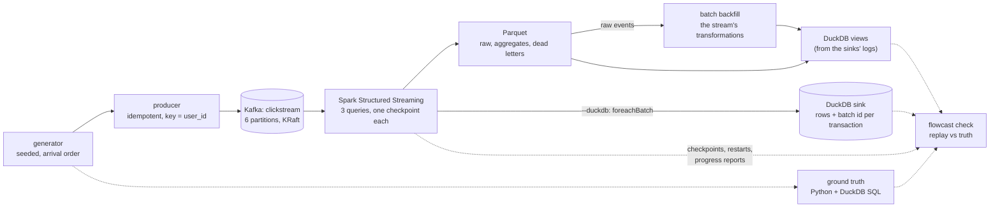

# FlowCast

A streaming analytics pipeline built end to end on one laptop: a synthetic clickstream goes through Kafka (KRaft
mode) and a Spark Structured Streaming job into Parquet files that DuckDB queries. The question it answers is per
minute of event time, how many events of each type happened and how much revenue purchases brought in; the questions
behind it are how fresh that answer is and how right it is when events arrive late, twice, or out of order.

The data is synthetic on purpose: the generator made every event, so the exact answer is known and every streaming
result can be checked against it.

## Status

| Day | What | State |
|---|---|---|
| 1 | Design, event schema, generator, ground truth, local Kafka, round trip, CI | done |
| 2 | Producer at volume; the Spark job (validate, dead letters, raw events, windowed aggregates); DuckDB views; the exact check | done |
| 3 | Exactly-once across killed and restarted jobs (file sinks, an idempotent DuckDB sink, SIGKILL tests); late-data accounting against Spark's metrics; schema version 2; batch backfill | done |
| 4 | Latency and throughput from the sink logs; benchmarks over batch sizes and trigger intervals; why small batches drop on-time records (a model of Spark's split, checked against the job); data-quality rules | done |
| 5 | Static HTML report, results, walkthrough, v1.0.0 | |

[DESIGN.md](DESIGN.md) is the specification for all five days; [WALKTHROUGH.md](WALKTHROUGH.md) has the questions an
interviewer is likely to ask, with answers grounded in the code.

## Architecture



Built so far (days 1 to 3): the whole pipeline; an exact check of its output; exactly-once across a job killed with
SIGKILL mid-batch and restarted (and what the kills taught about Spark's watermark); Spark's own late-row metrics
checked against the replay batch by batch; schema version 2 with readers of both; and a batch backfill that reuses the
stream's transformations and must equal the truth of every event.

## Layout

```
src/flowcast/
  schema.py               the event (versions 1 and 2): fields, strict decoder, byte-stable encoder
  generator.py            sessions, arrival order, late records, duplicates, determinism
  truth.py                exact minute aggregates in Python and DuckDB
  sql/minute_aggregates.sql
  kafka_io.py             topic creation, idempotent producer (settings, accounting), snapshot reader, counts
  pacing.py               replays arrival times against the wall clock
  spark_job.py            the job: parse (decode in a UDF), dead letters, raw events, dedupe, windows, start
  duckdb_sink.py          the idempotent DuckDB sink (rows + batch id in one transaction, bound to the query id)
  backfill.py             the batch backfill over the raw events, published by an atomic pointer
  restarts.py             each query's state at every start (which re-run batches the file sink skipped)
  recovery.py             kill the running job with SIGKILL at random moments, restart it
  layout.py               where a run writes (an output and a checkpoint per query, progress, backfill)
  check.py                the replay of a run's batches over Kafka, late-data accounting, and the report
  views.py                DuckDB views from the file sinks' logs; orphan files
  cli.py                  flowcast generate | truth | topic | produce | count | stream | check | backfill | query
scripts/kafka.sh          local single-node Kafka (start/stop/status/bootstrap/logs/reset)
scripts/kill_restart.py   the kill-and-restart run at size
scripts/measure_generator.py, scripts/measure_encode.py
tests/                    unit, property, differential, Kafka and Spark tests
```

## How to run

Needs Python 3.11 and, for Kafka and Spark, Homebrew's `kafka` (4.3.1) and `openjdk@21` (the Makefile points
`JAVA_HOME` at it). PySpark 4.2.0 comes with `make venv`; its Kafka source jars are fetched from Maven Central on first
use (into `~/.ivy2.5.2`).

```bash
make venv
make kafka-start
make check
```

`make check` runs ruff, ruff format, mypy --strict and the tests, Kafka and Spark ones included (they use their own
topics and delete them; about two minutes). `make kafka-stop` stops the broker; `scripts/kafka.sh reset` deletes its data.

Try the pieces:

```bash
.venv/bin/flowcast generate --sessions 2
.venv/bin/flowcast truth --sessions 1000 --engine duckdb
.venv/bin/flowcast topic
.venv/bin/flowcast produce --sessions 1000
.venv/bin/flowcast count
```

Run the job and check it:

```bash
.venv/bin/flowcast topic --topic demo
.venv/bin/flowcast produce --topic demo --sessions 10000
.venv/bin/flowcast stream --topic demo --out data/demo --available-now --max-offsets 2000
.venv/bin/flowcast check --topic demo --out data/demo
.venv/bin/flowcast query --out data/demo "SELECT * FROM minute_aggregates ORDER BY window_start LIMIT 10"
```

Exactly once, the backfill and schema version 2:

```bash
.venv/bin/flowcast stream --topic demo --out data/demo --available-now --max-offsets 2000 --duckdb
.venv/bin/flowcast backfill --out data/demo
.venv/bin/flowcast check --topic demo --out data/demo
.venv/bin/python scripts/kill_restart.py --topic kill-demo --out data/kill-demo --sessions 3000 --kills 10
.venv/bin/flowcast produce --topic demo --sessions 1000 --schema-version 2
```

`--duckdb` adds the DuckDB sink (`<out>/aggregates.duckdb`); `check` then holds it to its own query's replay, and it
holds a published backfill to the truth of every raw record. `kill_restart.py` produces to a new topic, kills the job
with SIGKILL at random moments, restarts it each time, and checks the result.

`stream` without `--available-now` runs until Ctrl-C, a batch every `--trigger` seconds (5); `produce --speed 1`
paces records by their arrival times (real time; 10 is ten times faster), and `--linger-ms`, `--batch-bytes` and
`--compression` set the producer's batching.

Measure a run and check its data (day 4):

```bash
.venv/bin/flowcast latency --out data/demo
.venv/bin/flowcast quality --out data/demo
.venv/bin/python scripts/bench.py sizes --topic kill-d3 --sizes 300,2000,10000
.venv/bin/python scripts/bench.py triggers --topic live --seconds 300 --sessions-per-second 100 --triggers 1,5,10
```

`latency` prints produced, event time and window end to queryable (p50, p95, p99, max) and each query's throughput;
event time is only meaningful for a run fed by `produce --speed 1 --start-ms now`. `quality` exits 1 when a rule
fails. `bench.py` writes its runs and `results.json` under `data/bench`.

`generate --sessions N` writes every record of N whole sessions (very late ones included); `--records N` is the first
N records of the endless stream, which is what a collector would have received by then. Both take `--seed`, the
disorder settings (`--late-fraction`, `--very-late-fraction`, `--duplicate-fraction`) and `--schema-version`.

## Results (day 1)

Synthetic data throughout.

Measured on an Apple M3 (macOS 26.6.2, Python 3.11.12), on battery, Low Power Mode off.

| What | Result | Command |
|---|---|---|
| Generator, 50,000 sessions (198,236 records) | **181,902 records/s** (1.090 s, median of 5) at `b6aefbb`; 200,425 (0.989 s) at `26b835e` | `.venv/bin/python scripts/measure_generator.py` |
| Generator + `encode` (validation and JSON) | **62,278 records/s** (3.183 s) at `b6aefbb`; 62,907 (3.151 s) at `26b835e`: encoding is about two-thirds of the time | same |
| Records the generator holds in memory | peak **1,810** pending (sampled every 1,024 records), 1,855 over the first 100,000 records of the endless stream | same; `test_memory_stays_bounded_while_streaming` |
| Records per session at the defaults | 3.9 (38,963 events in 10,000 sessions, plus 383 duplicate copies) | `.venv/bin/python -c "from flowcast.generator import sessions; c = sessions(10_000); print(len(c), sum(r.duplicate for r in c))"` |
| Determinism | the SHA-256 of the first 10,000 records is the same on macOS (here) and Linux (CI) | `test_the_first_10k_records_match_the_pinned_hash` |
| Kafka round trip | 300 sessions through a 6-partition topic: every record back byte for byte, one partition per user, each user's records in send order | `tests/test_kafka.py` |

Two runs on battery (40% and 28%): at `26b835e` with a review agent open but idle (load average 1.66 before, 2.06
after), and at `b6aefbb` right after the test suite had run (load 4.21 before, 3.85 after). Both made the same 198,236
records; the gap in generation speed isn't separated between the code (an event-time check per event was added) and
the load. These numbers size day 2's producer runs; the encode cost (the strict checks run on every record) is the
first thing day 2's volume producer will look at.

## Results (day 2)

Synthetic data. Apple M3, macOS 26.6.2, Python 3.11.12, PySpark 4.2.0 on Java 21.0.12; on AC power from 16:30 (the
battery at 22-42%, charging), with Vivek's own apps open (load average 8 to 17 during the runs).

| What | Result | Command |
|---|---|---|
| The exact check of a run | 39,346 records (10,000 sessions, default settings) read in **21 batches**: 39,291 kept, **55 dropped as late**, 0 invalid; **48 aggregate rows written, 48 expected: equal**; every batch's watermark as recomputed from the records; 39,346 raw events for 39,346 valid records read | the "Run the job and check it" commands above, at `f26b685`, topic `demo-d2`, `--max-offsets 2000` |
| That run's length | 46 s for `stream --available-now` (Spark's start included; three queries) | same |
| `encode` | **277,755 events/s**, from 101,924 at `e2f0a30` (2.8x; `dataclasses.astuple` was 180,914/s alone); same bytes | `.venv/bin/python scripts/measure_encode.py` (79,390 events, best of 7 interleaved rounds); on battery with a review agent running: 100,530 to 278,420 |
| `produce`, unpaced | 39,346 records (11.4 MB) in 0.56 s: **70,670 records/s**, generating and encoding included; acknowledgements by partition match the topic | `.venv/bin/flowcast produce --topic demo-d2 --sessions 10000` (one run) |
| `produce --speed 50` | 2,000 sessions (8,029 records) in 36.75 s, at most 6 ms behind schedule: the very late tail (up to 30 minutes of arrival time) sets the length | `.venv/bin/flowcast produce --sessions 2000 --speed 50` (one run, on battery) |

What these aren't: day 4's benchmarks. The job's throughput, the cost of the parse UDF and end-to-end latency are
measured there, on an idle machine.

## Results (day 3)

Synthetic data. Apple M3, macOS 26.6.2, Python 3.11.12, PySpark 4.2.0 on Java 21.0.12. The kill run ran on AC (the
battery charging from 40%) while another Claude Code session (the other portfolio track) ran its own work: load average
54.8 at the start, so its times are a busy laptop's, not benchmarks.

| What | Result | Command |
|---|---|---|
| Kill and restart at size | 3,000 sessions (11,966 events at 0.5 sessions a second of event time, plus 3 invalid records), 300 records a batch, **10 SIGKILLs** of the running job (driver, JVM and Python workers), 11 starts: every output exact. 494 aggregate rows written, 494 expected; **the DuckDB sink 494 of 494**; 11,966 raw events, each Kafka record once; 3 dead letters; 0 watermark differences | `.venv/bin/python scripts/kill_restart.py --topic kill-d3 --out data/kill-d3 --sessions 3000 --kills 10` at `c576dc4` (the script's DuckDB change uncommitted then, committed with this table) |
| Where the kills landed | across the 4 queries at the 10 kills: **30 planned but not logged, 6 logged but not committed**, 4 between batches; 15 raw-event and 2 dead-letter files left as orphans, never read | same |
| A skipped re-run in that run | batch 6 of `minute_aggregates` was logged but not committed at kill 6, so the next start re-ran it and the file sink skipped it; the start log named it, and every watermark matched the records once its records were left out | same |
| Late-data accounting | over the 33 of 42 batches with Spark's progress saved (killed runs save none; the skipped re-run is left out): **Spark's dedupe dropped 1,267 rows as late, the replay 1,267; duplicates 71 and 71**; the window aggregation dropped 0 | same |
| Rows dropped as late | 1,280 of 11,966 valid records in that run, against 55 of 39,346 in day 2's run at 2,000 records a batch; the replay agrees exactly either way. Why small batches over a backlog drop so many more is for day 4's batch-size comparison | same; day 2's demo |
| Its length | 266 s for all 11 rounds (each restart starts a JVM and Spark); 82 s for the last, uninterrupted one | same |
| The backfill of that run | **523 rows, equal to the truth of every raw record** (11,858 distinct events, very late ones included); the stream had written fewer events than the backfill in 234 of its 494 rows (1,263 events). 30.8 s at load average 37, Spark's start included; its first stage had 246 tasks, one per raw file: small batches make small files (day 4) | `.venv/bin/flowcast backfill --out data/kill-d3`, then `flowcast check --topic kill-d3 --out data/kill-d3` (ok, every line equal) |

The tests' runs (`test_recovery.py`, `test_kill.py`, `test_backfill.py`, `test_spark_stream.py`) check the same things on
smaller streams on every `make check` and in CI; the backfill there equals the truth of every event exactly.

## Results (day 4)

Synthetic data. Apple M3, macOS 26.6.2, Python 3.11.12, PySpark 4.2.0 on Java 21.0.12, Kafka 4.3.1 (one local broker,
6 partitions). Power: on AC with the lid closed, the Mac in a dark wake (no sleep during any run: `pmset -g log`'s last
sleep ended at 15:29:55, before the first); load average 26 to 30 while a job ran (Spark's `local[*]` and its Python
workers), about 4.5 between runs. No other portfolio session was running.

**Batch size over a backlog.** Day 3's kill-run topic (`kill-d3`: 11,969 records, 3,000 sessions at 0.5 a second of
event time, 3 invalid) read from nothing by `flowcast stream --available-now --max-offsets SIZE`, a fresh process and
run directory per size; "dropped" is the exact replay of the job's own batches (`check` passed on every run), and
"predicted" is `batching.simulate` from the records alone, without Spark:

| Records a batch | Batches | Wall time (JVM start included) | Records/s over the wall time | Dropped as late | Predicted |
|---|---|---|---|---|---|
| 300 | 41 | 101.0 s | 119 | **1,280 (10.69%)** | 1,280 |
| 2,000 | 6 | 68.4 s | 175 | 5 (0.04%) | 5 |
| 10,000 | 2 | 27.8 s | 430 | 0 | 0 |

`.venv/bin/python scripts/bench.py --out data/bench sizes --topic kill-d3 --sizes 300,2000,10000` at `2a4cece`
(results in `data/bench/results.json`). A topic this small measures per-batch overhead, not Spark's throughput: four
queries each read and parse every batch, and each batch writes Parquet files and commits four logs.

**Why small batches drop on-time records** (the question day 3 left open). Regenerating that stream to label every
record, 1,200 of the 1,280 dropped were on time (median lateness 128 ms; `.scratch/late_analysis.py`, not committed).
`maxOffsetsPerTrigger` splits a batch across partitions by what each has left, which levels record counts, not event
times, and the watermark is global. In a sparse stream a partition's records can cover far more event time than
another's: at the median batch end the leading partition was 388 s ahead of the slowest at 300 a batch, 423 s at 2,000
(`batching.skew`). A batch drops by the previous batch's watermark, which trails what it reads by the 180 s delay plus
about a batch's step: 138 s at 300 a batch, 1,011 s at 2,000. At 300 the lead passes the slow partitions' on-time
records; at 2,000 the step covers it. `batching.plan` reproduces Spark's split exactly: on that topic all 41 batches'
end offsets equal the real checkpoint's, and the predicted drops are the same 1,280 event ids
(`tests/test_spark_batching.py` holds a fresh job to the same on every run).

**Data quality.** `flowcast quality --out data/kill-d3`: all 16 rules and the dead-letter ceiling pass on day 3's kill
run (11,966 raw events, 494 windows, 3 dead letters: 0.0251% of records), and on each of the three batch-size runs
above (`flowcast quality --out data/bench/kill-d3-size-300`, and so on).

## Tests

- `tests/test_schema.py`: every rule of the field table refuses a bad value with its reason; JSON edge cases
  (duplicate keys, `NaN`, booleans and floats for integers, deep nesting); a Hypothesis round trip byte for byte.
- `tests/test_generator.py`: the pinned SHA-256 of the first 10,000 records; arrival order; delays matching their
  labels; duplicates identical and 0.1 to 5 s after their original; the disorder rates; the session rules (rebuilt
  from the events); bounded memory; a finite stream equal to the endless stream's records of the same sessions; a
  Hypothesis test of the invariants over random settings.
- `tests/test_truth.py`: hand-made windows with a duplicate and window edges; Python and DuckDB equal at the defaults
  and over random streams (Hypothesis); 9.9e12 cents summed exactly.
- `tests/test_kafka.py` (needs a broker): the round trip through a 6-partition topic (every value byte for byte, one
  partition per user, each user's records in send order); topic creation idempotent and partition counts checked; a
  produce to a missing topic fails rather than creating it.
- `tests/test_kafka_script.py` (`FLOWCAST_TEST_KAFKA_SCRIPT=1`, CI's kafka-script job): the script with a broker of its
  own: start twice, a round trip, data kept across a restart, reset; a busy port and a foreign directory refused.
- `tests/test_cli.py`: each command's output and exit codes.

- `tests/test_kafka_config.py`: the producer stays idempotent with `acks=all` (a fake producer, no broker); waits that
  could never end are refused.
- `tests/review/` and `tests/review2/`: the two day-1 reviews' findings as tests, each failing at the commit it
  reviewed (`943596b`, `a403362`).
- `tests/test_spark_rules.py` (Spark): the late-row rules on the job's own functions, one file per batch: the previous
  batch's watermark, inclusive, for the dedupe and the windows; the dedupe's state is evicted; revenue only for
  purchases.
- `tests/test_spark_parse.py` (Spark): `parse` gives `decode`'s verdict and reason on 257 records (234 good, 84 of them
  version 2; 23 bad); the dead letter and raw event split, columns and dates.
- `tests/test_spark_stream.py` (Kafka and Spark): 300 thin sessions (20% late, 5% very late, 5% duplicates) and four bad
  records through two runs of the job at 150 records a batch; the aggregates must equal the replay row for row, with
  watermarks as specified and more than 10 records dropped; raw events and dead letters reconcile; the DuckDB views
  match; the truth's SQL over the raw events equals the Python truth. Then the CLI: `stream`, `check`, `query` as
  subprocesses, and a forged aggregate row that `check` must reject.
- `tests/test_check.py`: the replay and `check_run` on hand-made checkpoints and run directories (no Spark, no broker).
- `tests/test_views.py`: reading the sink log (compaction, deletes, gaps, strangers, URIs) and the views.
- `tests/test_pacing.py`: the pacer on a fake clock.
- `tests/review_d2/`: the day-2 review's findings, each failing at `0eb546a`.

Day 3:

- `tests/test_recovery.py` (Kafka and Spark): a finished run put back into each state a crash leaves its last batch in
  (logged by the sink but not committed; or not logged, its files left as orphans), for all four queries, the DuckDB
  sink's included; restarted with new records; every output must reconcile exactly, the re-run batch must keep the
  offsets it planned, nothing may be counted twice (a glob of the directory would), and Spark's late and duplicate
  counts must equal the replay's.
- `tests/test_recovery.py`'s third test makes the kill test's finding deterministic: the run's trailing no-data batch
  taken away and the data batch before it cut off after its sink logged it; on restart the next batch keeps the
  skipped batch's watermark, and the check passes with the start log and fails without it.
- `tests/test_kill.py` (Kafka and Spark): three SIGKILLs of the running job at random moments, restarts, the check
  exact; the query states it records.
- `tests/test_restarts.py`: the restart log (a torn line from a killed start skipped), and which re-runs the file sink
  skipped.
- `tests/test_duckdb_sink.py`: a replayed batch is skipped, an empty batch counts, a gap or another query's batch is
  refused, and a window written twice rolls the whole batch back (no Spark).
- `tests/test_backfill.py` (Spark; one with Kafka): a streamed run's backfill equals the truth exactly and is never
  below the stream; raw files from before and after schema version 2 backfill to the truth; the pointer is validated.
- `tests/test_check.py` grew: orphans reported, a backfill held to the truth, a skipped re-run's records left out of the
  watermark (and only that batch's), the late-data accounting (per-batch counts, partial coverage, each difference
  failing). `tests/test_schema.py`, `test_generator.py`, `test_spark_parse.py` and `test_views.py` cover version 2.

Day 4:

- `tests/test_quality.py`: a clean run and an empty one pass; each of 20 broken rows fails exactly the rules it should
  (a window no raw event backs also fails the cross-check); a record twice, or both an event and a dead letter; a
  window twice; windows counting more events or revenue than raw (fewer is allowed); the dead-letter ceiling; the
  Parquet path through the views; the command's exit codes.
- `tests/test_latency.py`: nearest-rank percentiles; each batch's own files and commit time, through a compact file;
  a cleaned-up log refused; the three latencies from commit times set by hand; throughput from progress reports, empty
  batches left out; the command.
- `tests/test_batching.py`: Spark's split (shares of what's left, floored, ceil below 1, never past the end); a plan
  reads everything; on a backlog where one partition is sparse, small batches drop the dense partition's on-time
  records and larger ones fewer; the watermarks the model gives; the lead and the step.
- `tests/test_spark_batching.py` (Kafka and Spark): the real job's batches and drops equal the model's on a stream with
  nothing late.
- `tests/test_cli.py`: `--start-ms` (and `now`) and `--sessions-per-second`, their errors; its Kafka test now skips
  without a broker (its marks were on a helper).

CI (`.github/workflows/ci.yml`): lint and types, and every test in two halves on separate runners (`-m spark` and
`-m "not spark"`; conftest marks every test that takes the `spark` fixture), Spark on Temurin 21 with its jars cached,
against an `apache/kafka:4.3.1` service container; and `scripts/kafka.sh` against the Apache tarball (SHA-256 checked)
on Java 21. With the split, the Spark half took 6m26s and the rest 3m01s (run 40387756949), against 8m29s for the
one job on day 3.

## Review of day 1

One review agent read the day's code at `943596b` (16:04 to 16:26) with a correctness brief, ran its own broker on
other ports, and wrote each defect it reproduced as a failing test (10 tests in 6 files; one, the `product_id`
length, was settled by changing DESIGN's table instead, so `tests/review/` keeps the other 9, in 5 files). All fixed:

- **Python and DuckDB truths disagreed** when copies of an `event_id` differ: the SQL's `DISTINCT ON` had no order,
  so with 200,000 ids sent twice DuckDB counted the later copies. Both now keep the first copy in input order.
- **`ensure_topic` lost create races** (the broker's metadata lagged the controller: "has None partitions", 11 of 15
  races of 6 threads), and **a topic just created couldn't always be read** ("Not leader for partition", 7 of 60).
  `ensure_topic` now returns only once every partition has a leader; reads retry those settling errors.
- **`kafka.sh` trusted any live pid** in its pid file, so after a crash or reboot `stop` could kill an unrelated
  process that had been given the same pid. The pid's command line must now name this directory's config.
- **`max_session_events` wasn't a cap** (a purchase writes one event per cart line); **a start near 2100 made invalid
  events**; **`--wait nan` waited forever**; **a huge `--partitions` was a traceback**.

Of its 12 surviving mutants, 10 are caught now, each run again here as a mutant against the fixed code (bare `u`/`s`/`p` ids, a 33-character category, reading and counting
from a low watermark above 0, the producer's idempotence, the broker refusing auto-creation, the session cap, the
quantity cap, the closed-pipe exit code, `--partitions 0`); two are still open: the snapshot reader's skip of records
written after it started, and `delete_topic` swallowing errors. The test that a purchase empties the cart is new too:
the review's mutant that bought only the first line was caught only by the slow property test, and now fails the
10,000-session rules test as well. Its doubt about DESIGN's watermark accounting matched a correction already made from Spark's
source (`26b835e`).

A second agent then read only the fixes (`943596b..a403362`, 16:39 to 16:48) and found two regressions in them, both
fixed (`tests/review2/`, 4 tests): `kafka.sh`'s new pid check compared the config path as a string, so the same
directory spelled another way (a symlink; `/tmp` is `/private/tmp` on macOS; `./kafka`) made `stop` delete the pid
file of the live broker and leave it running unfound; the script now resolves the directory to its physical path
first, and keeps a pid file it can't verify. And `produce`'s new flush after an error was one long call into
librdkafka, which holds off Python's signal handling, so a second Ctrl-C couldn't end it; it flushes in 0.1 s slices
now. From its suspicions: every Kafka call refuses NaN or infinite timeouts, `ensure_topic`'s calls share one
deadline, and a prefix that wasn't all delivered says so on the error. No third review this time.

## Review of day 2

One review agent read the day's code at `0eb546a` (15:34 to 15:47, its own worktree and broker on other ports, a
correctness brief) and wrote four defects as failing tests (`tests/review_d2/`, 5 tests in 3 files); each failed here
before its fix and passes after:

- **One bad record could stop the job.** `decode`'s reason can quote a key; a JSON escape can make that key a lone
  surrogate (`{"\ud800":1,"\ud800":2}`), which Arrow can't encode, so the UDF threw, the task failed, and the query
  with it. Reasons are escaped to valid UTF-8 now (`29332c3`).
- `flowcast stream` gave a traceback when a query failed (its own report was unreachable), and DuckDB errors escaped
  `query` and `check` (`84b19c0`). The stream test needed a new trigger once the first fix landed: records deleted from
  Kafka before the job read them, which `failOnDataLoss` makes a failure.
- `raw_events` took columns from every `key=value` segment of the run directory's path (`83c8007`).

It ran 38 mutants and listed 16 as surviving (or not run against every test). 14 are killed now, each re-run here
as a mutant against the new tests: 7 in check.py and 5 in views.py (a throwaway script, not committed, applied each mutant, ran the tests and
restored the file from a copy), and in
spark_job.py `_revenue`'s `lit(1)` and `dropDuplicates` for `dropDuplicatesWithinWatermark` (against
`test_spark_rules.py`). The latter gives the same output with state that never shrinks, so a test checks the state
size (`f26b685`). The most important one, **a job run with a 2-minute watermark passed every test**: the replay now
recomputes every batch's watermark from the records and the report fails on a difference (`52f2023`), unit-tested
with 2- and 4-minute checkpoints and required by the end-to-end test; the job mutant itself wasn't re-run. The 16th,
`hive=False`, no longer exists after `83c8007`. Two of my own new mutants survived at first: one was an equivalent
`max()` (removed), the other got a test. Its suspicions, noted in the limitations: copies of an event_id that differ
(outside the spec) could make `check` report a correct job as wrong; `check` on a running job can race a commit.
It also said that its `pkill -f` had killed a process of my test run (see `b5b6b09` and `29332c3`'s messages).

## Review of day 3

No review agent today: the other portfolio track's session was running on the same machine for the whole window, and
two sessions plus an agent hit the account's usage limit once before (October 14). The day's own kill test did a
reviewer's job: it found the skipped re-run's watermark (above), which the hand-made crash states in `test_recovery.py`
hadn't shown: an available-now run ends with a batch that reads nothing (in the kill run, batch 41 had batch 40's end
offsets and 0 input rows), so cutting off the last batch loses no event times. A third test now takes that batch away
and cuts off the one before it, which reproduces the lag every time. The first run of the DuckDB sink's tests found that DuckDB's
`executemany` refuses an empty list, which most batches of a stream are; mutating the views' `union_by_name` away
fails the schema test.

## Design decisions

- **Integer cents and integer milliseconds**, so Python, DuckDB and Spark compute identical answers, compared with `==`.
- **A strict decoder** (no booleans or floats as integers, no `NaN`, no duplicate or unknown keys) that is the
  reference for day 2's dead letters.
- **Every draw from `random()` alone**, the one `random` method Python keeps stable for a seed; event ids hash (seed,
  sequence). Determinism is checked, not assumed: the pinned hash passes on macOS and Linux.
- **Disorder on purpose**: 3% late (at most about 2 minutes, inside the 3-minute watermark), 0.2% very late (5 to
  30 minutes, past it), 1% sent twice. Each exercises a different part of the streaming job.
- **Key = `user_id`**: a user's events stay in one partition, in order. **Idempotent producer**: the producer's own
  retries can't duplicate or reorder; the generator's duplicates stay, and the pipeline must remove them.
- **Topics are never auto-created**, and an existing topic with the wrong partition count is refused.
- **Validation is `decode` itself**, in an Arrow UDF: `from_json` keeps the last of two duplicate keys, ignores
  unknown keys and reads `NaN`, so it can't give the same verdicts. One definition of valid, at a Python call per record.
- **The check replays the job's own batches** (checkpoint offsets and watermarks) instead of trusting a metric: the
  stream's output must equal the truth of the records it had to keep, exactly.
- **Views read the sinks' logs**, never a glob: files of a failed batch are never seen.
- **Spark on loopback**, UTC, 6 state partitions, standard Parquet timestamps.
- **`kafka.sh` stops only its own pid** (`kafka-server-stop` would signal every broker on the machine), binds to
  loopback, and deletes only a directory it made.
- **Exactly once is each sink's job, and the replay is the proof**: the file sink skips a batch already in its log,
  the DuckDB sink skips a batch id already in its table (in the same transaction as the rows), and after any crash
  `check` must still find every output equal to the replay of its own query's batches.
- **The DuckDB sink is bound to its query's id**: batch ids restart at 0 with a new checkpoint, and a sink keyed by
  batch id alone would silently skip the new query's first batches as already written.
- **Record what the checkpoint can't say**: a file-sink batch re-run after a crash is skipped without being executed,
  so its records never move the watermark. Nothing in the checkpoint shows it; the job's start log does.
- **The backfill is the stream's own code**, published by renaming a pointer file, so a reader never sees half of it.
- **Readers before writers**: the decoder reads both versions; a producer upgraded first would send its records to
  dead letters, visibly, not to wrong answers.

## Limitations (day 3)

- Three queries (four with `--duckdb`) each read Kafka and run the parse UDF: that many times the reading and parsing
  of one query with a shared source (day 4 measures the cost).
- `flowcast check` must run on a stopped job: on a live one a batch can commit between its reads. It compares raw
  events and dead letters by count, not record by record.
- The check assumes copies of an event_id are identical, as the generator makes them; copies that differ (outside the
  spec, though `decode` accepts them) could make it report a correct job as wrong, and the backfill's `dropDuplicates`
  keeps an arbitrary copy.
- The late-data accounting covers only batches whose progress reports were saved: a run saves them when it ends, so a
  killed run's are lost (the check says how many batches it compared). A `StreamingQueryListener` would write them as
  they happen, but delivers them asynchronously, so the last ones can miss a run that stops.
- Explaining watermarks after a restart needs the start log: a run directory written without it (older code) can show
  watermark differences after a crash that the check can't attribute.
- The DuckDB sink has one writer, and DuckDB locks the file while a batch is written: a reader can open it only between
  batches. Orphan files and old backfill directories are reported or kept, never deleted.
- Event-time skew between devices isn't modelled: each event's time is its true time, and lateness is all in transit.
- One broker, replication factor 1, Spark in local mode: a laptop pipeline, not a fault-tolerant cluster.
- `read_topic` gives up on any consumer error rather than retrying transient ones, and can't finish a compacted or
  transactional topic (it reads to the high-water mark). Untested still: its skip of records written after the
  snapshot, and `delete_topic` swallowing errors.

## License

MIT
