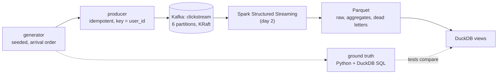

# FlowCast

A streaming analytics pipeline built end to end on one laptop: a synthetic clickstream goes through Kafka (KRaft
mode) and a Spark Structured Streaming job into Parquet files that DuckDB queries. The question it answers is per
minute of event time, how many events of each type happened and how much revenue purchases brought in; the questions
behind it are how fresh that answer is and how right it is when events arrive late, twice, or out of order.

The data is synthetic on purpose: the generator made every event, so the exact answer is known and every streaming
result can be checked against it.

## Status

| Day | What | State |
|---|---|---|
| 1 | Design, event schema, generator, ground truth, local Kafka, round trip, CI | done |
| 2 | Producer at volume; the Spark job (validate, dead letters, raw events, windowed aggregates); DuckDB views | |
| 3 | Exactly-once across restarts; late data; schema version 2; batch backfill | |
| 4 | Benchmarks (throughput, end-to-end latency, trigger intervals); data-quality checks | |
| 5 | Static HTML report, results, walkthrough, v1.0.0 | |

[DESIGN.md](DESIGN.md) is the specification for all five days; [WALKTHROUGH.md](WALKTHROUGH.md) has the questions an
interviewer is likely to ask, with answers grounded in the code.

## Architecture



Built so far (day 1): everything left of Kafka, Kafka itself, and the round trip through it.

## Layout

```
src/flowcast/
  schema.py               the event (version 1): fields, strict decoder, byte-stable encoder
  generator.py            sessions, arrival order, late records, duplicates, determinism
  truth.py                exact minute aggregates in Python and DuckDB
  sql/minute_aggregates.sql
  kafka_io.py             topic creation, idempotent producer, snapshot reader, partition counts
  cli.py                  flowcast generate | truth | topic | produce | count | version
scripts/kafka.sh          local single-node Kafka (start/stop/status/bootstrap/logs/reset)
scripts/measure_generator.py
tests/                    unit, property, differential and Kafka integration tests
```

## How to run

Needs Python 3.11 and, for Kafka, Homebrew's `kafka` (4.3.1) and `openjdk@21`.

```bash
make venv
make kafka-start
make check
```

`make check` runs ruff, ruff format, mypy --strict and the tests, Kafka ones included (they use their own topics and
delete them). `make kafka-stop` stops the broker; `scripts/kafka.sh reset` deletes its data.

Try the pieces:

```bash
.venv/bin/flowcast generate --sessions 2
.venv/bin/flowcast truth --sessions 1000 --engine duckdb
.venv/bin/flowcast topic
.venv/bin/flowcast produce --sessions 1000
.venv/bin/flowcast count
```

`generate --sessions N` writes every record of N whole sessions (very late ones included); `--records N` is the first
N records of the endless stream, which is what a collector would have received by then. Both take `--seed` and the
disorder settings (`--late-fraction`, `--very-late-fraction`, `--duplicate-fraction`).

## Results (day 1)

Synthetic data throughout.

Measured on an Apple M3 (macOS 26.6.2, Python 3.11.12), on battery, Low Power Mode off.

| What | Result | Command |
|---|---|---|
| Generator, 50,000 sessions (198,236 records) | **181,902 records/s** (1.090 s, median of 5) at `b6aefbb`; 200,425 (0.989 s) at `26b835e` | `.venv/bin/python scripts/measure_generator.py` |
| Generator + `encode` (validation and JSON) | **62,278 records/s** (3.183 s) at `b6aefbb`; 62,907 (3.151 s) at `26b835e`: encoding is about two-thirds of the time | same |
| Records the generator holds in memory | peak **1,810** pending (sampled every 1,024 records), 1,855 over the first 100,000 records of the endless stream | same; `test_memory_stays_bounded_while_streaming` |
| Records per session at the defaults | 3.9 (38,963 events in 10,000 sessions, plus 383 duplicate copies) | `.venv/bin/python -c "from flowcast.generator import sessions; c = sessions(10_000); print(len(c), sum(r.duplicate for r in c))"` |
| Determinism | the SHA-256 of the first 10,000 records is the same on macOS (here) and Linux (CI) | `test_the_first_10k_records_match_the_pinned_hash` |
| Kafka round trip | 300 sessions through a 6-partition topic: every record back byte for byte, one partition per user, each user's records in send order | `tests/test_kafka.py` |

Two runs on battery (40% and 28%): at `26b835e` with a review agent open but idle (load average 1.66 before, 2.06
after), and at `b6aefbb` right after the test suite had run (load 4.21 before, 3.85 after). Both made the same 198,236
records; the gap in generation speed isn't separated between the code (an event-time check per event was added) and
the load. These numbers size day 2's producer runs; the encode cost (the strict checks run on every record) is the
first thing day 2's volume producer will look at.

## Tests

- `tests/test_schema.py`: every rule of the field table refuses a bad value with its reason; JSON edge cases
  (duplicate keys, `NaN`, booleans and floats for integers, deep nesting); a Hypothesis round trip byte for byte.
- `tests/test_generator.py`: the pinned SHA-256 of the first 10,000 records; arrival order; delays matching their
  labels; duplicates identical and 0.1 to 5 s after their original; the disorder rates; the session rules (rebuilt
  from the events); bounded memory; a finite stream equal to the endless stream's records of the same sessions; a
  Hypothesis test of the invariants over random settings.
- `tests/test_truth.py`: hand-made windows with a duplicate and window edges; Python and DuckDB equal at the defaults
  and over random streams (Hypothesis); 9.9e12 cents summed exactly.
- `tests/test_kafka.py` (needs a broker): the round trip through a 6-partition topic (every value byte for byte, one
  partition per user, each user's records in send order); topic creation idempotent and partition counts checked; a
  produce to a missing topic fails rather than creating it.
- `tests/test_kafka_script.py` (`FLOWCAST_TEST_KAFKA_SCRIPT=1`, CI's kafka-script job): the script with a broker of its
  own: start twice, a round trip, data kept across a restart, reset; a busy port and a foreign directory refused.
- `tests/test_cli.py`: each command's output and exit codes.

- `tests/test_kafka_config.py`: the producer stays idempotent with `acks=all` (a fake producer, no broker); waits that
  could never end are refused.
- `tests/review/` and `tests/review2/`: the two day-1 reviews' findings as tests, each failing at the commit it
  reviewed (`943596b`, `a403362`).

CI (`.github/workflows/ci.yml`): lint, types and every test against an `apache/kafka:4.3.1` service container; and
`scripts/kafka.sh` against the Apache tarball (SHA-256 checked) on Java 21.

## Review of day 1

One review agent read the day's code at `943596b` (16:04 to 16:26) with a correctness brief, ran its own broker on
other ports, and wrote each defect it reproduced as a failing test (10 tests in 6 files; one, the `product_id`
length, was settled by changing DESIGN's table instead, so `tests/review/` keeps the other 9, in 5 files). All fixed:

- **Python and DuckDB truths disagreed** when copies of an `event_id` differ: the SQL's `DISTINCT ON` had no order,
  so with 200,000 ids sent twice DuckDB counted the later copies. Both now keep the first copy in input order.
- **`ensure_topic` lost create races** (the broker's metadata lagged the controller: "has None partitions", 11 of 15
  races of 6 threads), and **a topic just created couldn't always be read** ("Not leader for partition", 7 of 60).
  `ensure_topic` now returns only once every partition has a leader; reads retry those settling errors.
- **`kafka.sh` trusted any live pid** in its pid file, so after a crash or reboot `stop` could kill an unrelated
  process that had been given the same pid. The pid's command line must now name this directory's config.
- **`max_session_events` wasn't a cap** (a purchase writes one event per cart line); **a start near 2100 made invalid
  events**; **`--wait nan` waited forever**; **a huge `--partitions` was a traceback**.

Of its 12 surviving mutants, 10 are caught now, each run again here as a mutant against the fixed code (bare `u`/`s`/`p` ids, a 33-character category, reading and counting
from a low watermark above 0, the producer's idempotence, the broker refusing auto-creation, the session cap, the
quantity cap, the closed-pipe exit code, `--partitions 0`); two are still open: the snapshot reader's skip of records
written after it started, and `delete_topic` swallowing errors. The test that a purchase empties the cart is new too:
the review's mutant that bought only the first line was caught only by the slow property test, and now fails the
10,000-session rules test as well. Its doubt about DESIGN's watermark accounting matched a correction already made from Spark's
source (`26b835e`).

A second agent then read only the fixes (`943596b..a403362`, 16:39 to 16:48) and found two regressions in them, both
fixed (`tests/review2/`, 4 tests): `kafka.sh`'s new pid check compared the config path as a string, so the same
directory spelled another way (a symlink; `/tmp` is `/private/tmp` on macOS; `./kafka`) made `stop` delete the pid
file of the live broker and leave it running unfound; the script now resolves the directory to its physical path
first, and keeps a pid file it can't verify. And `produce`'s new flush after an error was one long call into
librdkafka, which holds off Python's signal handling, so a second Ctrl-C couldn't end it; it flushes in 0.1 s slices
now. From its suspicions: every Kafka call refuses NaN or infinite timeouts, `ensure_topic`'s calls share one
deadline, and a prefix that wasn't all delivered says so on the error. No third review this time.

## Design decisions

- **Integer cents and integer milliseconds**, so Python, DuckDB and Spark compute identical answers, compared with `==`.
- **A strict decoder** (no booleans or floats as integers, no `NaN`, no duplicate or unknown keys) that is the
  reference for day 2's dead letters.
- **Every draw from `random()` alone**, the one `random` method Python keeps stable for a seed; event ids hash (seed,
  sequence). Determinism is checked, not assumed: the pinned hash passes on macOS and Linux.
- **Disorder on purpose**: 3% late (at most about 2 minutes, inside the 3-minute watermark), 0.2% very late (5 to
  30 minutes, past it), 1% sent twice. Each exercises a different part of the streaming job.
- **Key = `user_id`**: a user's events stay in one partition, in order. **Idempotent producer**: the producer's own
  retries can't duplicate or reorder; the generator's duplicates stay, and the pipeline must remove them.
- **Topics are never auto-created**, and an existing topic with the wrong partition count is refused.
- **`kafka.sh` stops only its own pid** (`kafka-server-stop` would signal every broker on the machine), binds to
  loopback, and deletes only a directory it made.

## Limitations (day 1)

- Nothing reads the topic yet except the tests: the Spark job is day 2.
- The generator is single-threaded Python; `produce` sends as fast as it can, with no pacing by arrival time (day 2).
- Event-time skew between devices isn't modelled: each event's time is its true time, and lateness is all in transit.
- One broker, replication factor 1: this is a laptop pipeline, not a fault-tolerant cluster.
- `read_topic` gives up on any consumer error rather than retrying transient ones, and can't finish a compacted or
  transactional topic (it reads to the high-water mark). Untested still: its skip of records written after the
  snapshot, and `delete_topic` swallowing errors. A topic deleted in the middle of a create race is reported as "not
  served" after the full timeout.

## License

MIT
